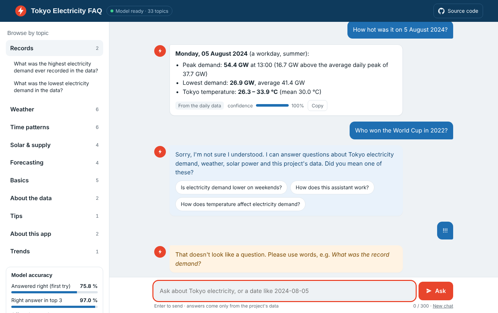
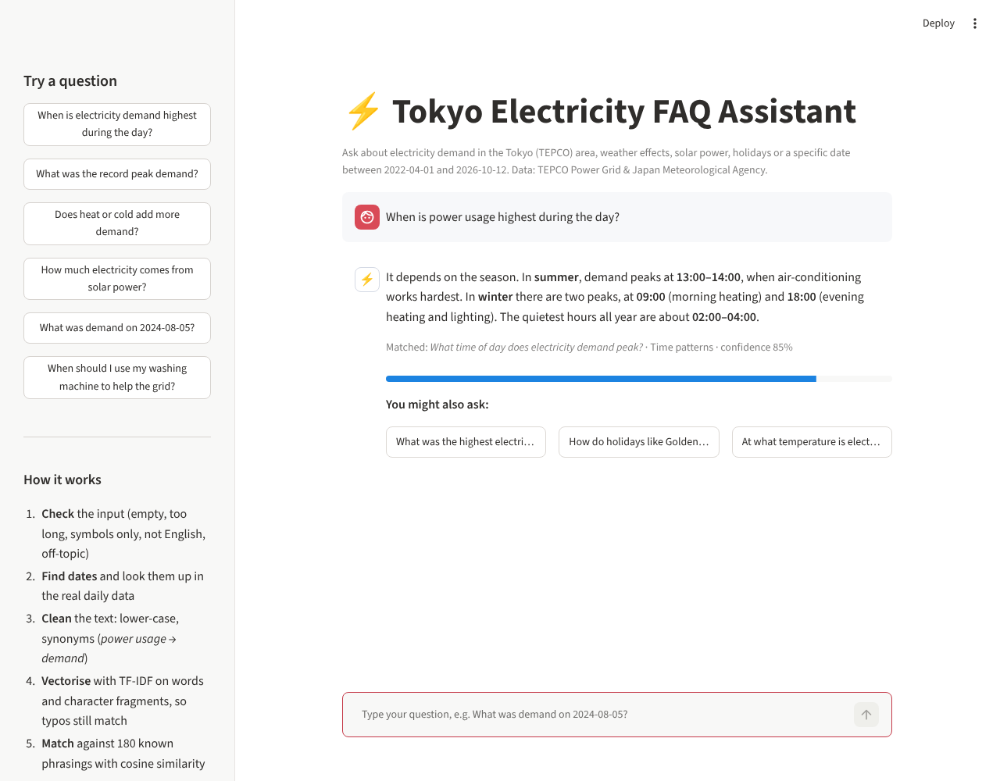
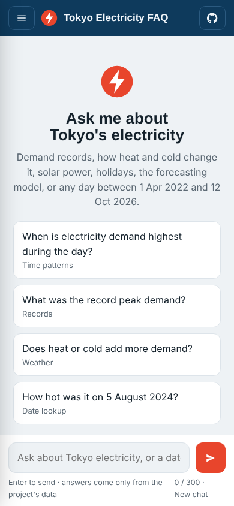
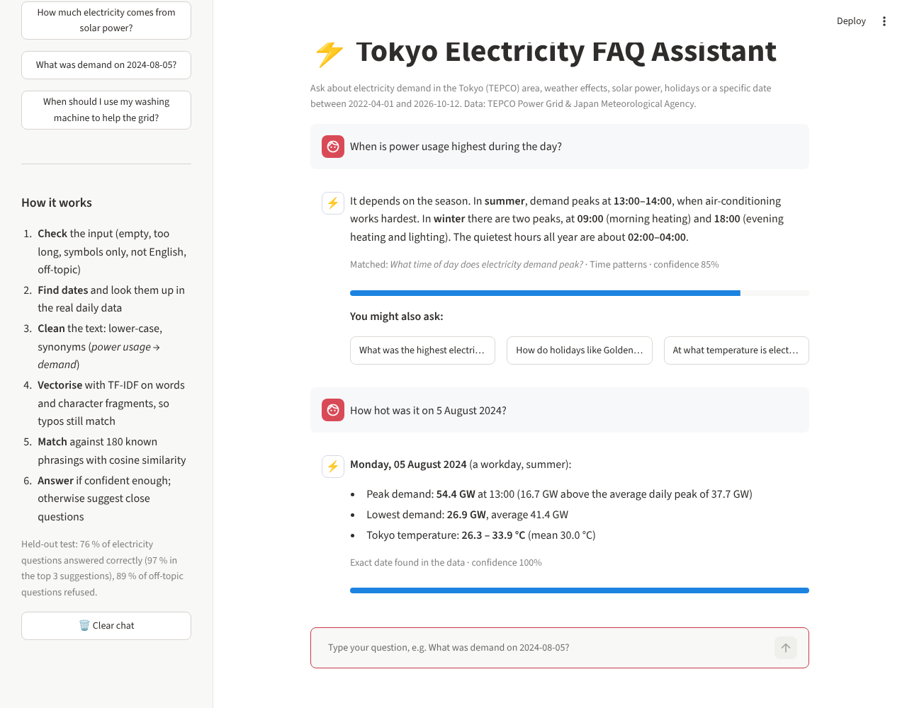
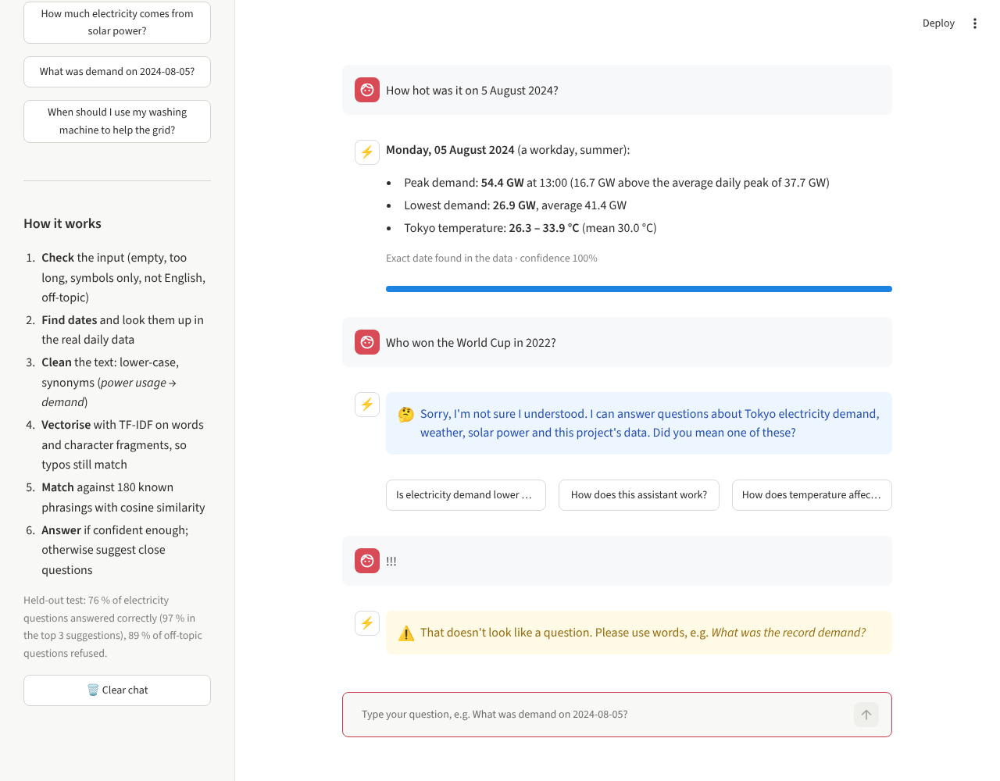
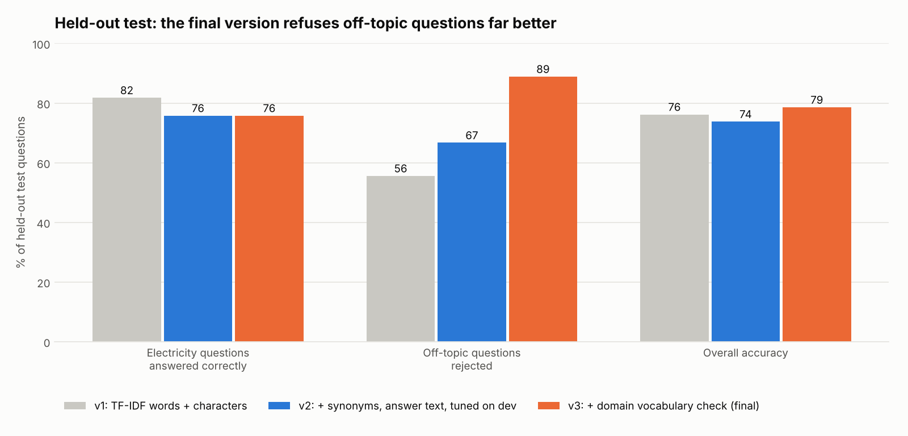
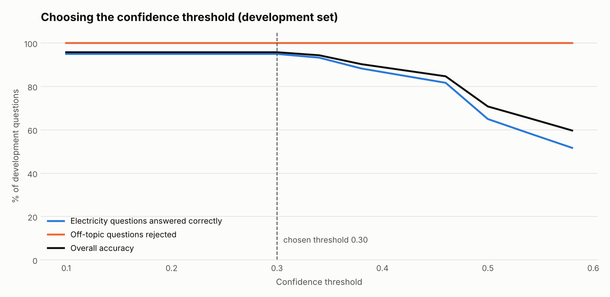

# ⚡ Tokyo Electricity FAQ Assistant

A small **NLP question-answering app**. Ask a question in plain English about electricity demand in the Tokyo area, the weather, solar power or holidays, and the assistant finds the best answer. If your question contains a date, it looks that day up in the real data. Empty, invalid and off-topic input is handled with a helpful message instead of a wrong answer.

**Try it live:** **[Web app (GitHub Pages)](https://sylvi007.github.io/Tokyo-Electricity-FAQ-Assistant/)**

The answers come from my earlier projects analyzing **TEPCO Power Grid "でんき予報"** demand data and **Japan Meteorological Agency (気象庁)** weather data (39,744 hourly records, April 2022 – October 2026).



## Two versions of the same app

| | **Streamlit app** (`app.py`) | **Web app** (`index.html`) |
|---|---|---|
| Built with | Python, scikit-learn, Streamlit | HTML, CSS, JavaScript (no server) |
| Model | `qa_engine.py` | `engine.js`, a line-by-line port of `qa_engine.py` |
| Hosting | Streamlit Community Cloud | GitHub Pages |
| Same answers? | ✓ | ✓ identical on all 124 test questions (confidence within 0.0001) |

The **Python version is the original**. The JavaScript version runs the same model directly in the browser, so it loads instantly, works on any phone, and needs no server. `data.json` holds the knowledge base, the settings and the daily data, exported from the Python files.

| Streamlit app | Web app on a phone |
|---|---|
|  |  |

## Features

| Requirement | How it's done |
|---|---|
| **Accept user input** | A chat box, starter questions, a **topic browser** listing all 33 questions by category, and clickable "Related questions" |
| **Process the input** | Validation, date detection, text normalization (lower-case, synonyms such as *power usage → demand* and *hottest → hot*, removing filler words) |
| **Run the AI/ML model** | TF-IDF vectors (words + character n-grams) and cosine similarity against **180 phrasings** of **33 answers**, plus a domain-vocabulary check that detects off-topic questions |
| **Display the result** | The answer, a category tag, a **confidence meter**, a copy button, and related questions |
| **Handle invalid/empty input** | Empty or whitespace-only, symbols only (`!!!`), too long (over 300 characters, with a live counter), non-English (`電気の需要は？`), dates that don't exist (`2024-02-30`) or are outside the data range, and off-topic questions ("Who won the World Cup?") |
| **Usable interface** | App-style layout, light and dark mode, a mobile menu, a typing indicator, keyboard support, and accessible focus states |

| Date lookup | Invalid and off-topic input |
|---|---|
|  |  |

## How the model works

```
question ──► 1. validate ──► 2. date? ──yes──► look up the day in the daily data
                                  │no
                                  ▼
             3. normalise (lower-case, synonyms, filler words)
             4. TF-IDF vectors: words (1–2-grams) + character 3–5-grams (catches typos like "recrod")
             5. cosine similarity with all 180 known phrasings (+ the answer texts, weighted lower)
             6. confident AND on-topic? ──yes──► answer + related questions
                                        └─no──► "not sure" + 3 suggested questions
```

This is a **retrieval-based** model: it never invents an answer. Every answer comes from `faq.json`, and every number in it was calculated in my earlier analysis projects.

## Evaluation

I wrote two sets of test questions **separately from the knowledge base**, each with electricity questions and off-topic questions:
- `dev_questions.csv` (72 questions): used while improving the model.
- `final_test_questions.csv` (42 questions): held out to compare versions fairly.

| Version (held-out test) | Electricity questions answered correctly | Right answer in top 3 | Off-topic questions refused | Overall |
|---|---:|---:|---:|---:|
| v1: TF-IDF words + characters | 81.8 % | 97.0 % | 55.6 % | 76.2 % |
| v2: + synonyms, answer text, tuned on the dev set | 75.8 % | – | 66.7 % | 73.8 % |
| **v3: + domain-vocabulary check (final)** | **75.8 %** | **97.0 %** | **88.9 %** | **78.6 %** |



**What I learned:**
- Tuning on the dev set raised its score to 95.8 %, but v2 got *worse* on the held-out test. That's **overfitting**: I had adjusted the model to fit the dev questions. The held-out set caught it.
- v3 replaced fragile tuning with a general rule: a question must mention an electricity, weather, calendar or data term. Off-topic rejection rose from 56 % to 89 %, and v3 has the best overall score.
- Trade-off: v3 answers slightly fewer electricity questions right on the first try than v1 (76 % vs 82 %). But the right answer is in the **top 3 for 97 %** of them, and the app shows those as clickable suggestions.
- Honest note: v3 was designed after looking at v2's held-out mistakes, so its held-out score is somewhat optimistic.



**Remaining weaknesses:** questions that are close in meaning but need different answers, for example "the record peak" vs "the peak hour of the day". Sentence embeddings (e.g. a small transformer model) would understand these better than word overlap.

## Files

All files are in one folder (plus the Streamlit theme in `.streamlit/config.toml`).

| File | Contents |
|---|---|
| `app.py` | The Streamlit app |
| `qa_engine.py` | The NLP engine: validation, date lookup, normalization, TF-IDF, similarity, decision |
| `index.html`, `engine.js`, `data.json` | The web app and its JavaScript copy of the model |
| `faq.json` | Knowledge base: 33 answers and 180 phrasings |
| `tokyo_daily_summary.csv` | Daily peak/low demand and temperatures for date lookups (1,656 days) |
| `evaluate.py` | Measures accuracy on both question sets and makes the charts |
| `dev_questions.csv`, `final_test_questions.csv` | Test questions with the expected answers |
| `evaluation_results.csv`, `evaluation_summary.json` | Results for every test question |
| `fig_*.png`, `screenshot_*.png` | Charts and screenshots |
| `requirements.txt` | Python packages |

## How to run

```bash
pip install -r requirements.txt
streamlit run app.py              # Streamlit app at http://localhost:8501
python evaluate.py                # re-runs the evaluation
python -m http.server 8000        # web app at http://localhost:8000
```

Data © TEPCO Power Grid and the Japan Meteorological Agency (processed), compiled through [kaseee/tokyo-grid-lab](https://github.com/kaseee/tokyo-grid-lab).
